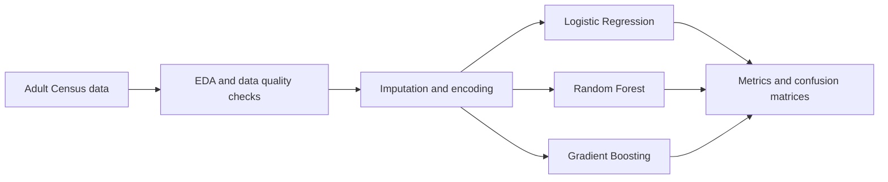

# Adult Income Classification

> An end-to-end classical machine-learning workflow for predicting whether annual income exceeds USD 50K from census attributes.


## Overview

This repository explores the UCI Adult Census Income dataset in three stages: exploratory analysis, preprocessing design, and model comparison. The final pipeline handles mixed numerical and categorical data, trains several classifiers, and exports reproducible evaluation artifacts.



## What is included

- exploratory data analysis and five publication-ready plots;
- explicit handling of `?` missing-value markers;
- median/mode imputation, scaling, one-hot encoding, and binary encoding;
- stratified train/test splitting with a fixed random seed;
- Logistic Regression, Random Forest, and Gradient Boosting baselines;
- Accuracy, Precision, Recall, F1, ROC-AUC, classification reports, and confusion matrices;
- CSV and JSON exports for later comparison.

## Repository structure

| Path | Purpose |
|---|---|
| `lab7_task1.py` | data understanding and exploratory visualisation |
| `lab7_task2.py` | preprocessing and feature-engineering prototype |
| `lab7_task3.py` | complete training and evaluation pipeline |
| `adult.data`, `adult.test` | local copies of the Adult dataset |
| `outputs/` | generated metrics, reports, and confusion matrices |
| `plots/` | exploratory plots |

## Run locally

```bash
python -m venv .venv
# Windows: .venv\Scripts\activate
# macOS/Linux: source .venv/bin/activate
pip install numpy pandas matplotlib seaborn scikit-learn
python lab7_task1.py
python lab7_task3.py
```

Run the scripts from the repository root because the dataset paths are relative to that directory.

## Evaluation focus

The target is imbalanced, so Accuracy alone is not treated as sufficient. The final comparison includes Precision, Recall, F1 and ROC-AUC, with the full confusion matrix retained for each model.

## Notes

This is an educational benchmarking project. Predictions based on demographic data can reproduce historical bias and should not be used for real employment, credit, or eligibility decisions without a separate fairness and governance assessment.
